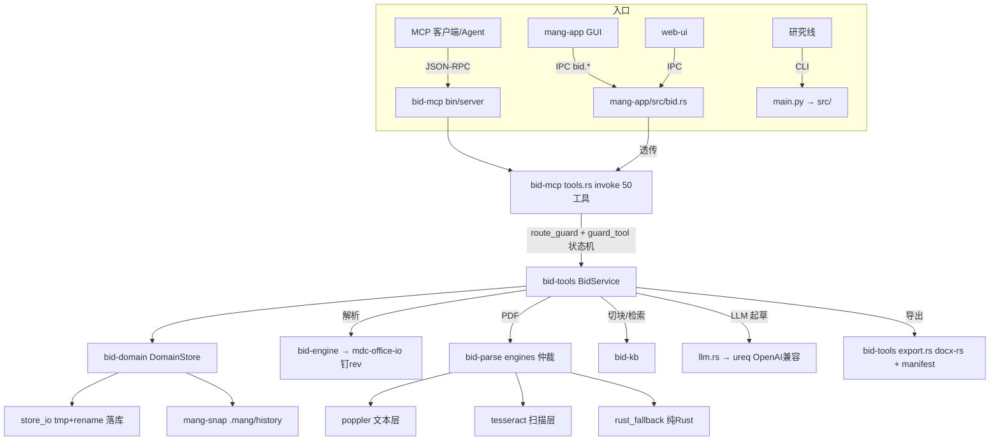

# 全量盘点报告（#117 · 审计阶段1）

> 基线：main `24967de`（2026-11-12 收官真测提交）。方法：目录/模块逐项 Read + grep 消费方验证（零消费=孤岛须双证：生产 grep + 测试 grep）。
> 结论分级：【已证实】= 本轮源码/grep 证据；【部分证实】= 证据在但覆盖不全；【待验证】= 需运行时验证（转阶段2-4）。
> 本报告只盘点不改代码；可修问题登记 §8 转阶段7（#123）。

---

## 1. 模块清单（四类代码区分）

类别口径：**生产**=终端用户/Agent 可达路径；**研究**=公告研究线（PYTHON-BOUNDARY 隔离）；**原型**=历史首轮实现（保留为回归线）；**基建**=测试/夹具/脚本/文档。

### 1.1 Rust workspace（bidcore/，9 crates）

| 模块 | 规模 | 职责（lib.rs 头注） | 类别 | 完成度 | 消费方（grep 证实） |
|---|---|---|---|---|---|
| bid-domain | 25,929 行 src / 11 测试 | 领域模型+权威状态机（ID 命名空间 PRJ/TF/REQ/EV/CMP/SEC/VF/RT；诚实状态纪律） | 生产 | 生产可用 | parse/tools/mcp/mang-app 全依赖 |
| bid-parse | 16,703 / 23 | 确定性解析层：PDF 引擎仲裁（poppler→tesseract→rust_fallback，#200 R2）+ 条款抽取 + 评分表/审查表 | 生产 | 生产可用 | bid-tools/bid-mcp |
| bid-tools | 19,500 / 37 | 服务层薄壳（工具只做校验/裁决/转发）+ LLM 通路（ureq OpenAI 兼容，#68） | 生产 | 生产可用 | bid-mcp/mang-app |
| bid-mcp | 12,072 / 68 | MCP 分发骨架 + 50 工具（TOOL_NAMES lib.rs:77）+ 5 bins | 生产 | 生产可用 | MCP 客户端 / mang-app IPC |
| bid-engine | 1,784 / 10 | mdcore 引擎适配**唯一接触面**（mdc-office-io 钉 rev f4328ebf，build.rs 注入 #327） | 生产 | 生产可用 | parse/tools/kb 三方 |
| bid-grade | 1,309 / 4 | corpus-A 判分器（grade.py Rust 移植）+ bidgrade CLI | 基建 | 生产可用（判分线） | run_tests T5/T11 |
| bid-kb | 531 / 2 | AdapterA 知识库：确定性切块（chunk_id 内容寻址）+ exact 五类检索 | 生产 | 生产可用 | bid-tools context.rs:38 / runner.rs:10 |
| mang-app | 13,537 / 0(外置) | 标书桌面壳（只读预览；AI 经 MCP 写，壳只显示；内嵌 #[cfg(test)]） | 生产 | 生产可用 | 终端用户 |
| mang-snap | 508 / 0(外置) | .mang/history 快照写端单一真源（#42 阶段7） | 生产 | 生产可用 | mang-app IPC + bid-mcp save_version |

### 1.2 仓内其他代码

| 模块 | 规模 | 职责 | 类别 | 完成度 | 证据 |
|---|---|---|---|---|---|
| m1/ | 单 crate（canon/chunk/extract/import…） | 首轮原型（并行会话产出）；bidcore 为演进版 | 原型 | 保留为回归线 | run_tests.py:19「T10~T13 被测系统=m1；bidcore 为演进版」 |
| src/（Python） | 50 文件 9,390 行 | 公告研究管道：collect→extract(LLM)→analyze→report | 研究 | 生产可用（研究线） | main.py 自述「非生产链路」+ docs/PYTHON-BOUNDARY.md |
| web-ui/ | TS/JS | mang web 预览 + 标书工作台面板 | 生产 | 17 测试文件全绿（收官五面之一） | web-ui/tests/*.mjs |
| sdk/ | skill+examples | bid-response-pipeline Skill（P1-P8 七篇 references）+ e2e | 生产(Agent侧) | e2e 在位 | sdk/tests/test_mcp_e2e.py |
| scripts/ | 30+ 脚本 | run_tests 主链 T0-T19 / closeout_real_test / rust-env / engine_probe / veto_gt / bid_health_check / e2e_bid | 基建 | 分项可用 | 逐脚本头注 |
| fixtures/ | 10 目录 | corpus-A/R（合成 GT）、songling-232762（**65页真件** #251）、real-tender-batch1/2、synth-tender、performance-samples | 基建 | 完整（T3 sha256 门） | fixture_spec.py 派生计数 |
| real-corpus/ real-samples/ | 4 域 | 真实语料（water/telecom/gov + 示范文本） | 基建 | 完整 | PROVENANCE.md |
| research/ docs/ audit/ baseline/ artifacts/ | — | 计划/契约/审计归档/基线/产物 | 文档 | — | — |

### 1.3 入口面清单（调用图起点）

| 入口 | 位置 | 说明 |
|---|---|---|
| MCP stdio server | bid-mcp bin/server.rs | JSON-RPC 2.0 换行分帧（#137），Agent 主入口 |
| MCP 简化 stdio | bin/stdio.rs | 逐行 tool/args（Claude Desktop 最简接线） |
| CLI 启动器 | bin/cli.rs | #314 --init/--doctor 自检 |
| A8 验收 | bin/a8.rs | 真实 docx→导入→抽取→矩阵一条命令（#2 §B5） |
| tool_surface | bin/tool_surface.rs | 工具面注册表唯一真源校验+派生重生成 |
| bidgrade | bid-grade [[bin]] | 判分 CLI + --self-test |
| mang-app | bin tao/wry GUI | IPC bid.* 20 面（bid.rs） |
| web-ui | 浏览器 | 经 mang-app IPC |
| Python | main.py | collect/extract/analyze/pipeline（研究线） |
| sdk | minimal_flow.py + SKILL.md | Agent 工作流 |

---

## 2. 调用图（生产链）



关键纪律（源码头注证实）：工具薄壳（mcp-contract §0）；状态机一律 guard_tool；未实现≠成功（typed UNIMPLEMENTED_INTERNAL）；OOXML 读面单一真源=引擎（bid-parse 已删自研 zip/quick-xml/calamine 栈，#11 任务3）。

## 3. 端到端数据流

```
招标文件(PDF/DOCX/XLSX/.doc)
  → import_tender_files（sha256 幂等 + 引擎路由 + 围栏/限额）
  → ParsedFile(blocks + file_sha + kind)          [语义/正则双路标记: get_document_chunks/submit_block_marks]
  → extract_requirements（#196 kind 分发 + 前缀兜底 + merge + ZERO_REQ 告警）
  → Requirement(类别7 + params + 锚点 + ★)
  → build_matrix + build_outline（评分驱动 + 三轨配额）
  → SEC 树(target_chars) + 矩阵行(blocking 派生)
  → register/bind Evidence(EV, 四态+tier) + 业绩库
  → draft（readiness 八阻塞 + LLM）→ 章节正文
  → validate(四桶) → 审校三门(receipt 验签 + digest 绑定)
  → export 门 1a-1m → docx(原子 tmp+rename + manifest) + 证据体检单
```

八阶段 P0-P8 全链贯通【已证实——收官真测 24967de 三面真跑，371 REQ/47 叶/55,794 字/BLOCKER=0】；但真实 LLM 通路在收官中走 mock【已证实——REPORT.md 自述】，真实验收由 #113 承接【待验证】。

---

## 4. 死代码与孤岛（零生产接线清单）

| # | 模块 | 证据 | 定性 |
|---|---|---|---|
| D-1 | bid-domain/src/export_gate.rs（ExportPhase 两阶段门） | 自述 NOT_WIRED（:11-17「全仓仅 tests/four_contracts.rs 引用」）；产品原子性由 export.rs manifest+tmp+rename 承载 | **登记债**（非隐藏死码——自文档诚实） |
| D-2 | bid-domain/src/impact.rs（V2 SEMUL 影响面引擎） | 生产消费方仅 changediff.rs（自身亦未接线）+ rewrite.rs 仅文档对齐引用；测试 impact 相关在 four_contracts/changediff_chain | **孤岛**【已证实——grep 全仓】 |
| D-3 | bid-domain/src/changediff.rs（#320 多轮改标对比） | lib.rs pub mod 注册 + 专属测试；**零工具/服务消费**（grep bid-tools/bid-mcp 零命中） | **伪完成**（功能+测试齐、无接线）【已证实】 |
| D-4 | m1/ 整仓 | run_tests T10-T13 仍真跑（并行线回归） | 有意保留（非死码），成本=每轮构建耗时 |

无其他零引用 pub 模块（逐 crate lib.rs mod 清单 × grep 交叉，TODO/FIXME 全仓仅 4 处且全为占位检测词表——bid-grade/grade.rs:17、check.rs:57/144/147，非债务标记）。

## 5. 重复实现清单

| # | 面 | 两侧 | 重复度评估 |
|---|---|---|---|
| R-1 | OOXML 解析 | ~~bid-parse 自研栈~~ 已删 vs mdc-office-io | **已收敛**（#11 任务3，单一真源）【已证实】 |
| R-2 | PDF 解析 | bid-parse/engines（poppler CLI+tesseract+pdf_text 纯 Rust）vs mdcore PDF 栈 | **并存**，分工=bid-parse 管标书 PDF 文本面；边界无文档→转 #121（阶段5 BID/mdcore 边界定界）【部分证实】 |
| R-3 | DOCX 生成 | bid-tools/export.rs（docx-rs 0.4，image 特性关默认防 rav1e OOM #35）vs mdcore DOCX 写面 | **并存**，转 #121 定界【部分证实】 |
| R-4 | 原型 vs 演进 | m1/ vs bidcore/ | 文档已声明分工（run_tests:19），非意外重复【已证实】 |
| R-5 | 抽取 | src/extract（公告 LLM 抽取）vs bid-parse（招标文件确定性抽取） | 领域不同（公告 vs 标书），PYTHON-BOUNDARY.md 划界【已证实】 |

## 6. 伪完成清单（壳/仅文档/仅测试）

| # | 项 | 证据 | 定性 |
|---|---|---|---|
| P-1 | changediff（#320） | 见 D-3 | 伪完成（待接线或显式降级为域内分析件） |
| P-2 | EXPORTING 中间态 | export_gate NOT_WIRED（D-1） | 登记债（SC-01 承诺面在产品路径不存在——注释自认） |
| P-3 | LLM 真实通路 | llm.rs 实装（#68 三阶段）+ 收官 mock | 实装在位、真实验收缺【待验证→#113】 |

其余核查面（50 工具逐一有实现+测试；17 面板有测试；五面回归在 24967de 全绿：cargo workspace/run_tests T0-T19/bid-tools 429/bid-mcp 391/web-ui 16）无壳【已证实】。

## 7. 能力完成度总表

| 能力面 | 状态 | 证据锚点 |
|---|---|---|
| P0-P8 八阶段链路 | 生产可用 | 收官真测三面（24967de） |
| 50 MCP 工具 | 生产可用 | TOOL_NAMES lib.rs:77 + dispatch_contract 测试 + tool_surface 真源校验 |
| 导出门 1a-1m（含 #88 修复1-8） | 生产可用（生效面复核→阶段2/3） | service.rs export_document；fatal_gates_e2e.rs |
| 暗标防线 | 生产可用 | darkbid.rs 九类泄露面 + 1f 联动门 + bidder_name 硬门（#107） |
| 证据/业绩/补遗/评分四面板 | 生产可用 | #94/#111 + web-ui bid-panels 测试 |
| 版本快照 | 生产可用 | mang-snap 单一真源 |
| 真实语料回归 | 生产可用 | songling-232762（65页真件）+ real-corpus 四域 |
| 公告研究管道 | 生产可用（研究线） | main.py + 903 pytest |

## 8. 转阶段7（#123）登记（AUD2-INV 系列初号）

| 编号 | 级 | 项 | 建议处置 |
|---|---|---|---|
| AUD2-INV-01 | P2 | changediff/impact 零生产接线（D-2/D-3/P-1） | 二选一：接线（多轮改标对比入工具面）或显式标注「域内分析件、非产品面」；不许无主漂浮 |
| AUD2-INV-02 | P3 | export_gate NOT_WIRED 登记债（D-1/P-2） | 维持登记（manifest 已覆盖原子性）；SC-01 承诺面文档口径对齐 |
| AUD2-INV-03 | P2 | PDF 双栈/DOCX 生成与 mdcore 边界未文档化（R-2/R-3） | 转 #121 出拆分方案 |
| AUD2-INV-04 | P3 | m1 回归线保留成本 | 维持（回归价值>成本）；在 m1/README 标注退役条件 |

## 9. 与旧审计（6105beb，audit/README.md）差异对照

- 工具面 25→50；OOXML 解析自研栈已删（单一真源）；mang-app 已并入 workspace（FG-01 收口 #303）
- 旧六链断点（P0-1/P0-2/A-01…A-23/B-01/B-02/#244）大部分有对应修复 commit——**逐项真实生效面复核转阶段2（#118）/阶段3（#119）**，本阶段不重复报
- 新增：导出门 1e-1m、业绩库、分段改写、四面板、收官真测编排

## 10. 阶段1结论

仓库结构分层清晰（入口/服务/领域/解析/引擎适配），四类代码边界基本诚实（研究线/原型线均有文档自认）。全量盘点发现的可疑面集中在**「域内已实现、生产未接线」**（changediff/impact/export_gate 三件，均非投标关键路径）与**「双栈并存无边界文档」**（PDF/DOCX 与 mdcore，转阶段5）。生产主链（50 工具/八阶段/导出门族）在 24967de 五面回归绿，无壳无假绿假象（旧 FG-01~18 的复核转阶段4 #120）。
